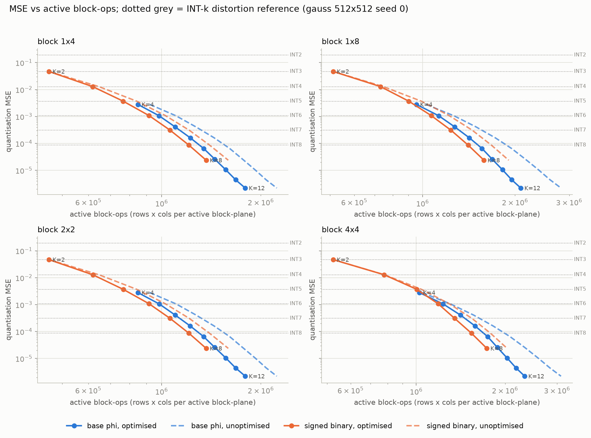
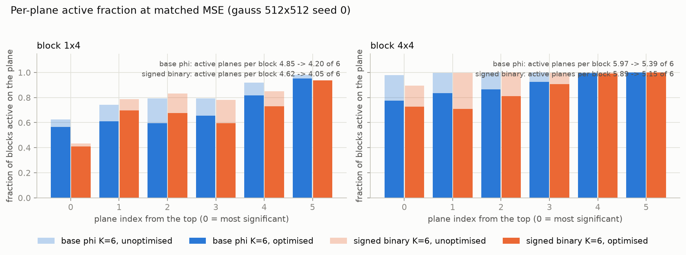
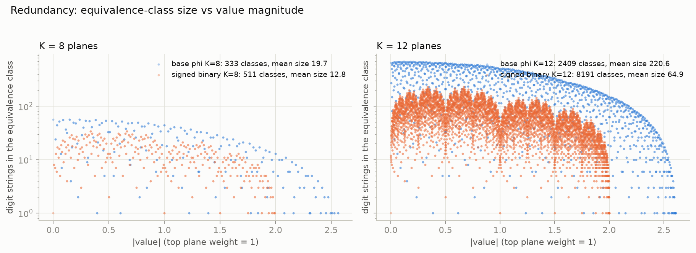

# Quantization with Phi

*Can the redundancy of base-φ arithmetic be turned into cheaper neural-network inference? I spent a few days finding out. The answer is no, and this repo is the record of how I got there.*

---

## 1. How it started: Armstrong numbers in class

We were doing a recursion exercise on Armstrong numbers. An n-digit number is an Armstrong number if it equals the sum of its digits each raised to the power n:

```
153 = 1³ + 5³ + 3³
```

The interesting part came after the exercise. There are only finitely many of them, and the proof is a one-liner: an n-digit number is at least 10^(n-1), but the largest possible digit-power sum is n · 9^n. Once n is large enough, the sum can never catch up to the number, so no Armstrong number can have that many digits.

I wanted to see that crossover, so I plotted both sides against n. Then I asked the obvious next question: what happens in other bases? The general condition is

```
n · (b - 1)^n  <  b^(n-1)
```

and while sweeping b as a real number on the graph, I started wondering what a *non-integer* base even means. That search led me to Bergman's 1957 paper on base φ, the golden ratio.

## 2. The property that sent me down the hole

The golden ratio satisfies

```
φ² = φ + 1        (φ = (1 + √5) / 2 ≈ 1.618)
```

Divide through by φ² and you get `1 = φ⁻¹ + φ⁻²`. In positional notation with base φ that means

```
100_φ  =  011_φ
```

and the same identity holds at every shift. A single value therefore has **many** digit strings. Base 10 and base 2 do not do this: every integer has exactly one plain binary representation.

That non-uniqueness looked like a free lunch. If a number can be written in several ways, maybe you can pick the representation that suits the hardware rather than the one that suits the maths.

## 3. Why I thought it mattered for neural networks

Bit-serial and digit-plane accelerators evaluate a quantised weight matrix one bit plane at a time. Take a matrix of 8-bit weights, split it into eight binary planes (the 1s plane, the 2s plane, the 4s plane, and so on) and each plane is a 0/1 matrix. If a whole block of a plane is zero, the hardware can skip it.

So the question became:

> A quantised weight is fixed. In base φ it has several equivalent digit strings. Can I choose, per weight, the string that makes whole blocks of digit planes go to zero, and so skip more work than binary allows, without changing a single quantised value?

That is exactly what the first three notebooks test.

## 4. The experiments

All four notebooks are in [`notebooks/`](notebooks/), numbered in the order I wrote them. The first three use a small MLP trained on MNIST and quantise its 128 × 784 first-layer weight matrix. They are committed without outputs; run them to reproduce.

### 01. Matrix-level redundancy
[`01_matrix_redundancy.ipynb`](notebooks/01_matrix_redundancy.ipynb)

Build the full 8-digit base-φ codebook (digits in {0, 1}, 256 strings), group strings by exact value, and quantise the matrix once to the nearest φ value. Freeze those values. Then search all 2⁸ subsets of digit planes to find the smallest set of planes that can still represent every value in the matrix exactly. The point was to see whether whole planes could be switched off for free.

### 02. Block-structured sparsity
[`02_block_sparsity.ipynb`](notebooks/02_block_sparsity.ipynb)

Whole-plane elimination is too coarse, so this notebook works per spatial block (4 × 4 up to 32 × 32). Experiment A keeps every quantised value exact and picks equivalent φ strings to minimise active plane-blocks. Experiment B lets both φ and INT8 move values slightly, and sweeps a penalty on distortion versus structure to get a Pareto curve of MSE and MNIST accuracy against zero-block fraction.

### 03. Inference cost model
[`03_inference_cost_model.ipynb`](notebooks/03_inference_cost_model.ipynb)

Turns block counts into a cost model: active blocks, active digits, sparse storage with metadata, and a break-even analysis asking how much more expensive a φ block-op may be than a binary one before φ stops winning. No hardware timing claims; a Python prototype loop is included only to show the block traversal works.

### 04. The fair comparison, and the verdict
[`04_phi_vs_signed_binary.ipynb`](notebooks/04_phi_vs_signed_binary.ipynb)

This is the notebook that ended the rabbit hole. Working on the first three, I noticed I had been comparing base φ *with* a block optimiser against plain binary *without* one. Binary is also redundant once digits are allowed to be signed: `2^(k+1) - 2^k = 2^k`, the same freedom that canonical signed digit (CSD) and non-adjacent form (NAF) representations exploit. The honest experiment is to give both bases signed digits {-1, 0, 1}, give both the **same** block optimiser, and compare active block-ops at **matched quantisation MSE**.

What it does:

- Enumerates all 3^K digit strings exactly (for φ, `φ^k = F_k · φ + F_(k-1)` with Fibonacci numbers, so every string maps to an integer pair and equality is exact). At K = 8 the 6561 φ strings collapse into 333 value classes, versus 511 for signed binary. φ really is more redundant.
- Quantises Gaussian and Laplacian 256 × 256 and 512 × 512 matrices over three seeds with a grid-searched scale, for φ with K = 4..12 planes and binary with K = 2..8.
- Per block (1×4, 1×8, 2×2, 4×4) picks one digit string per entry to minimise the number of active planes. Greedy plane elimination with several orders and random restarts on every block; an exact subset-closure dynamic programme on a 200-block sample per configuration as a reference (mean gap 0.37 %, worst 2.9 %), plus an ILP cross-check where a solver was installed.
- Interpolates the φ curve to each binary MSE and reports the ratio of active block-ops.



The solid lines are both bases after the same optimiser. At every matched MSE, the φ curve sits to the right of the binary curve: more work, not less.



The optimiser does help φ (planes per block drop from 4.85 to 4.20 of 6 on 1×4 blocks) but it helps binary by about as much (4.62 to 4.05).



The redundancy is real and grows fast with K. It just is not the right kind of redundancy.

**Verdict** (full tables in [`results/q1_decision.md`](results/q1_decision.md)):

| | ratio of active block-ops, φ / binary, at matched MSE |
|---|---|
| Gaussian, 1×4 blocks | 1.066 to 1.082 |
| Gaussian, 4×4 blocks | 1.035 to 1.100 |
| Laplacian, all shapes | 1.058 to 1.124 |

The pass criterion I set in advance was a ratio below 0.9. Nothing came close. **NO-GO.**

## 5. Why φ loses

φ needs `1 / log₂(φ) ≈ 1.44` times as many planes as binary to cover the same dynamic range. To break even on block-ops, each φ plane would have to be active in fewer than 0.69 times as many blocks as a binary plane. The measured per-plane density ratio was 0.94 to 1.10. The extra representations exist, but the string that zeroes a plane in one entry rarely lines up with the strings that zero the same plane in its neighbours, so block-level agreement is nearly as hard in φ as it is in signed binary.

What would overturn this:

- a weight distribution with far more structure than Gaussian or Laplacian (real trained layers were only tested at small scale in notebooks 01 to 03);
- a cost model where plane count is free and only active digits matter (φ's nonzero-digit ratio was also above 1, so this does not help either);
- a different base whose redundancy is aligned with plane elimination rather than merely abundant.

I do not currently think any of these is likely, but the code is here if someone wants to try.

## 6. Reproduce

```bash
python3 -m venv .venv && source .venv/bin/activate
pip install -r requirements.txt
jupyter lab
```

Notebook 04 needs only NumPy and Matplotlib and takes about three minutes on a laptop; it writes to `figs/` and `results/`. Notebooks 01 to 03 also need PyTorch and torchvision, download MNIST into `data/`, and train a small MLP for three epochs each. Every notebook is seeded.

`results/` holds the CSVs and the decision table from the run behind the figures above. The 5 MB `.npz` of optimised digit planes is ignored by git; notebook 04 regenerates it.

## References

- G. Bergman, "A Number System with an Irrational Base", *Mathematics Magazine*, 1957.
- E. Zeckendorf, on representing integers as sums of non-consecutive Fibonacci numbers, 1972.
- G. W. Reitwiesner, "Binary Arithmetic", *Advances in Computers*, 1960. Origin of the signed-digit / NAF redundancy that made the fair comparison necessary.

## Licence

MIT. See [LICENSE](LICENSE).
